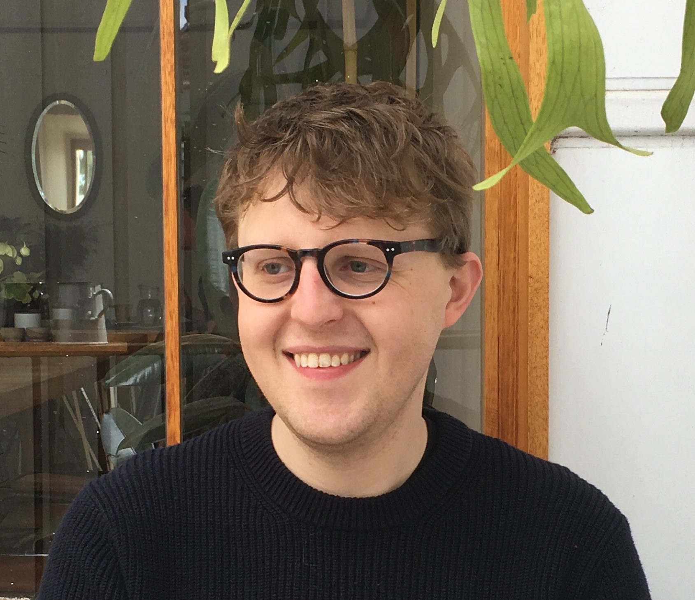

::: {.hero}
::: {.hero-content}
{.hero-photo}

::: {.hero-text}
# Stuart Lee {.hero-title}

Data scientist working in genomics.
I build tools that make complex data accessible.

[About](about.qmd){.btn .btn-primary}
[Writing](posts.qmd){.btn .btn-secondary}
[Publications](publications.qmd){.btn .btn-secondary}
:::
:::
:::

::: {.section-label}
Something I built
:::

::: {.spotlight}
::: {.spotlight-card .glass-card}
### plyranges

Tidy data principles for genomic ranges. Part of the [tidyomics](https://tidyomics.github.io/tidyomics/) ecosystem.

[GitHub](https://github.com/tidyomics/plyranges){.btn .btn-secondary .btn-sm}
[Documentation](https://tidyomics.github.io/plyranges/){.btn .btn-secondary .btn-sm}
:::
:::

::: {.section-label}
Elsewhere
:::

::: {.rooms-grid}
::: {.room-card}
[☕Coffee](rooms/coffee.qmd)
:::

::: {.room-card}
[🎬Film](rooms/film.qmd)
:::

::: {.room-card}
[📚Books](rooms/books.qmd)
:::

::: {.room-card}
[📝Notes](rooms/notes.qmd)
:::

::: {.room-card}
[🔗Internet](rooms/internet.qmd)
:::
:::

::: {.section-label}
Now
:::

::: {.now-section}
**Reading**

- *Breaking Things at Work* — Gavin Mueller
- *The Wall* — Marlen Haushofer

**Watching**

- *Twin Peaks: The Return*
:::
